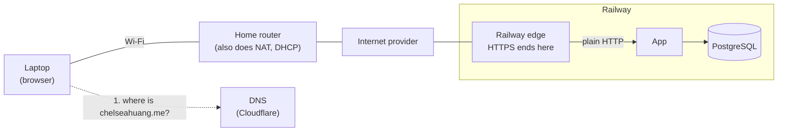
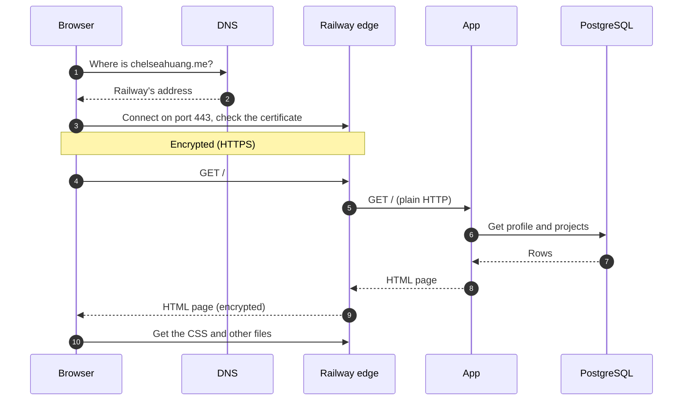

# Request path: chelseahuang.me from home Wi-Fi

Drawn 2026-10-20 from the repository's records, after the work was done. Assumptions: home Wi-Fi, nothing cached, a new TCP connection, no `www`.

Home network details (private IP, router model, resolver, ISP hops) are typical examples, not observations. See [Unknowns](#unknowns).

## 1. Where things are (Railway, live)

Solid line: the web request. Dotted line: the DNS lookup, a separate question asked first.

## 2. The order things happen

Details left out of the pictures, worth saying out loud:

- Typing `chelseahuang.me` first tries `http://` on port 80. The site redirects to `https://` (expected on Railway, not yet checked).
- DNS uses UDP port 53. Your resolver asks Cloudflare, which holds the record pointing to Railway.
- Your home router swaps your private IP for your home's public IP (NAT), and maps the reply back.
- The browser checks the certificate's name, dates and issuer before sending anything.
- The GA4 script loads from Google, and analytics events go from the browser straight to Google, not through your server.

## 3. What changes on Azure

- Cloudflare answers with an **A record pointing to the VM's static public IP**, not a CNAME to Railway.
- The Railway box becomes **NSG** (80 and 443 open, 22 from the laptop only, nothing on 8000) → **nginx** (handles the :80 → 301 redirect, TLS ends here, Let's Encrypt certificate renewed by the certbot timer) → **uvicorn on 127.0.0.1:8000** (2 workers under systemd) → **SQLite file** on the VM's disk.
- The database step is a file read inside the app process, not a network connection.

## Sources in this repo

| Claim | Source |
|---|---|
| Root CNAME to Railway, DNS only | `docs/evidence/dns-before-zoho.md` (2026-10-13) |
| Start command and proxy headers | `Procfile` |
| `DATABASE_URL`, connection per request | `src/career_platform/config.py`, `src/career_platform/database.py` |
| GA4 tag | `src/career_platform/templates/base.html` |
| Azure NSG, nginx, systemd, loopback | `docs/superpowers/plans/2026-10-01-operate-the-vm.md` |
| Azure TLS, redirect, renewal | `docs/how-this-site-is-secured.md` (2026-10-08) |
| Azure SQLite file | `docs/superpowers/plans/2026-09-24-azure-vm-migration.md` |

## Unknowns

| Unknown | Check |
|---|---|
| Laptop's private IP, subnet, gateway, DNS server | `ipconfig /all` |
| Which roles the home router combines | Device label or admin page |
| Who the resolver is | `ipconfig /all`; `nslookup chelseahuang.me` |
| ISP and internet hops | `tracert chelseahuang.me` |
| Railway's HTTP → HTTPS redirect | `curl -sI http://chelseahuang.me/` |
| Railway certificate issuer and dates | `openssl s_client -connect chelseahuang.me:443 -servername chelseahuang.me \| openssl x509 -noout -subject -issuer -dates` |
| Railway internals (region, Postgres host and port) | Railway dashboard |
