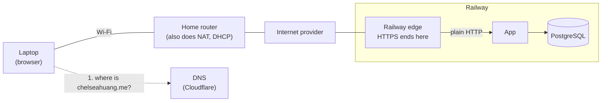
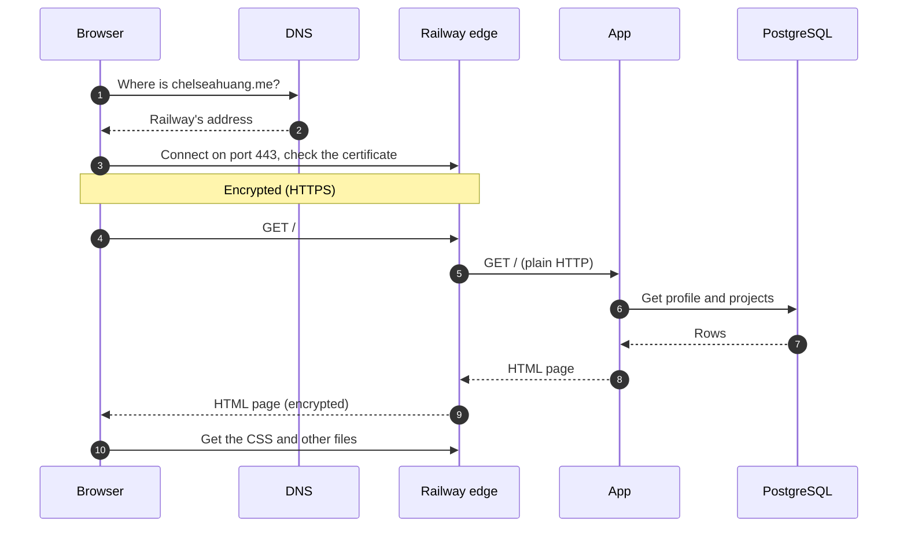
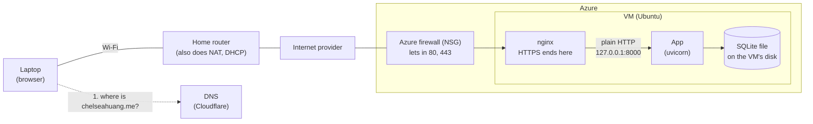
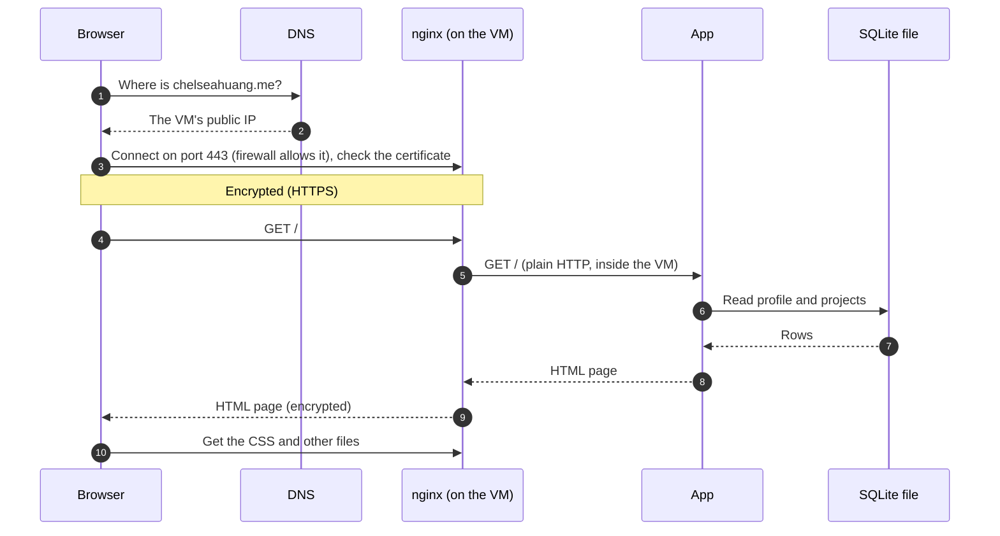
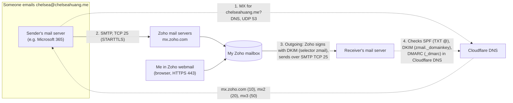
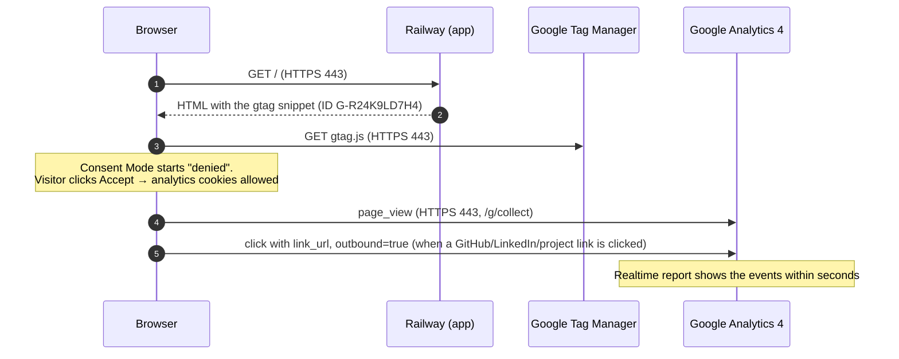

# Request path: chelseahuang.me from home Wi-Fi

Drawn 2026-10-20 from the repository's records, after the work was done. Assumptions: home Wi-Fi, nothing cached, a new TCP connection, no `www`.

Home network details (private IP, router model, resolver, ISP hops) are typical examples, not observations. See [Unknowns](#unknowns).

## 1. Where things are (Railway, live)

Solid line: the web request. Dotted line: the DNS lookup, a separate question asked first.

## 2. The order things happen

Details left out of the pictures, worth saying out loud:

- Typing `chelseahuang.me` first tries `http://` on port 80. Railway answers `301` to `https://` (checked 2026-10-25).
- DNS uses UDP port 53. Your resolver asks Cloudflare, which holds the record pointing to Railway.
- Your home router swaps your private IP for your home's public IP (NAT), and maps the reply back.
- The browser checks the certificate's name, dates and issuer before sending anything.
- The GA4 script loads from Google, and analytics events go from the browser straight to Google, not through your server.

## 3. Azure VM with SQLite (earlier)

The home side is the same. Everything after the internet happens on one Ubuntu VM.

### What's different from Railway

- Cloudflare answers with an **A record pointing to the VM's static public IP**, not a CNAME to Railway.
- The Railway box becomes **NSG** (80 and 443 open, 22 from the laptop only, nothing on 8000) → **nginx** (handles the :80 → 301 redirect, TLS ends here, Let's Encrypt certificate renewed by the certbot timer) → **uvicorn on 127.0.0.1:8000** (2 workers under systemd) → **SQLite file** on the VM's disk.
- The database step is a file read inside the app process, not a network connection.

## 4. Email path (Zoho, added 2026-10-25)

Mail never touches Railway or the VM. Cloudflare only answers the DNS questions; Zoho stores and sends the mail.

Evidence: [ex06.md](../evidence/ex06.md) (deliveries and authentication results), [zoho-header-check.md](../evidence/zoho-header-check.md), [dns-https-final.md](../evidence/dns-https-final.md) (records).

## 5. Analytics path (GA4, added 2026-10-25)

The page comes from Railway, but analytics data goes from the visitor's browser straight to Google. My server never sees it.

Evidence: [ex06.md](../evidence/ex06.md) §3 and [ex06-ga4-events.png](../evidence/ex06-ga4-events.png).

## 6. `www` (added 2026-10-25)

`www.chelseahuang.me` is a **proxied** Cloudflare record. The browser connects to Cloudflare (HTTPS 443 with Cloudflare's certificate, or HTTP 80), and a Cloudflare redirect rule answers `301` to `https://chelseahuang.me/<same path>`. The browser then follows the bare-domain path in §1–2. Nothing behind `www` is ever contacted. See [dns-https-final.md](../evidence/dns-https-final.md).

## Sources in this repo

| Claim | Source |
|---|---|
| Root CNAME to Railway, DNS only | `docs/evidence/dns-before-zoho.md` (2026-10-13) |
| Start command and proxy headers | `Procfile` |
| `DATABASE_URL`, connection per request | `src/career_platform/config.py`, `src/career_platform/database.py` |
| GA4 tag | `src/career_platform/templates/base.html` |
| Azure NSG, nginx, systemd, loopback | `docs/superpowers/plans/2026-10-01-operate-the-vm.md` |
| Azure TLS, redirect, renewal | `docs/how-this-site-is-secured.md` (2026-10-08) |
| Azure SQLite file | `docs/superpowers/plans/2026-09-24-azure-vm-migration.md` |

## Unknowns

| Unknown | Check |
|---|---|
| Laptop's private IP, subnet, gateway, DNS server | `ipconfig /all` |
| Which roles the home router combines | Device label or admin page |
| Who the resolver is | `ipconfig /all`; `nslookup chelseahuang.me` |
| ISP and internet hops | `tracert chelseahuang.me` |
| ~~Railway's HTTP → HTTPS redirect~~ | Checked 2026-10-25: `301 -> https://chelseahuang.me/` ([dns-https-final.md](../evidence/dns-https-final.md)) |
| ~~Railway certificate issuer and dates~~ | Checked 2026-10-25: Let's Encrypt YR2, 2026-10-08 to 2027-01-06 ([dns-https-final.md](../evidence/dns-https-final.md)) |
| Railway internals (region, Postgres host and port) | Railway dashboard |
