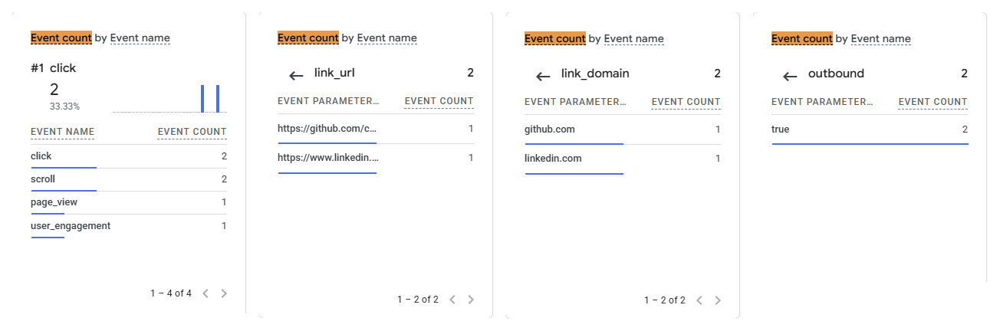

# Exercise 06: Domain email and Google Analytics

Domain: `chelseahuang.me`. Mail is hosted on Zoho Mail (free plan); DNS stays on Cloudflare. The outside mailbox is my school mailbox, hosted on Microsoft 365. Times are Pacific.

## 1. Email tests

| Test | Time | Result |
|---|---|---|
| Received | 2026-10-13 14:53 | "Test 01: inbound" sent from the outside mailbox arrived in the Zoho inbox at `chelsea@chelseahuang.me`. |
| Replied | 2026-10-20 01:55 | "Re: Test 01: inbound" sent from Zoho webmail as a reply to the received message (`In-Reply-To` set). It arrived in the outside mailbox's Inbox with `Chelsea Huang <chelsea@chelseahuang.me>` in From. |
| Sent a new message | 2026-10-13 14:56 | "Test 02: Outbound" sent from `chelsea@chelseahuang.me` arrived in the outside mailbox with `Chelsea Huang <chelsea@chelseahuang.me>` in From. Microsoft delivered it to the Inbox (`SCL:1`, `dest:I`); I later found it in Junk. |

## 2. SPF, DKIM, and DMARC

From the outside mailbox's header for the reply, "Re: Test 01: inbound" (receiver `mx.microsoft.com`, 2026-10-20 08:55 UTC). Lines copied unchanged; my personal address is left out.

```
Authentication-Results: mx.microsoft.com 1; spf=pass (sender IP is
 165.173.180.52) smtp.mailfrom=chelseahuang.me; dkim=pass (signature was
 verified) header.d=chelseahuang.me;dmarc=pass action=none
 header.from=chelseahuang.me;compauth=pass reason=100
Received-SPF: Pass (protection.outlook.com: domain of chelseahuang.me
 designates 165.173.180.52 as permitted sender)
 receiver=protection.outlook.com; client-ip=165.173.180.52;
 helo=sender6-of-o52.zoho.com; pr=C
```

| Check | Result |
|---|---|
| SPF | pass, `chelseahuang.me`, sent from Zoho (`sender6-of-o52.zoho.com`) |
| DKIM | pass, `d=chelseahuang.me`, selector `zmail` |
| DMARC | pass, `header.from=chelseahuang.me`, policy `p=none` |

The earlier "Test 02: Outbound" showed `dmarc=bestguesspass` because it was sent five minutes before I created the `_dmarc` record. This reply, sent after the record existed, shows a real `pass`.

## 3. Google Analytics 4

- Live site: https://chelseahuang.me/
- Privacy page: https://chelseahuang.me/privacy

The GA4 tag (`G-R24K9LD7H4`) loads on every page. Consent Mode defaults analytics storage to denied until the visitor accepts in the consent bar.

GA4 Realtime, 2026-10-20 about 02:20, after accepting analytics in the consent bar and clicking the GitHub and LinkedIn links in the Contact section. Left to right: events by name (`page_view` 1, `click` 2), then the `click` event's `link_url`, `link_domain`, and `outbound` values. Cropped to the event card.



DebugView stayed empty because debug mode was not turned on for my browser, so I used the Realtime report instead.
