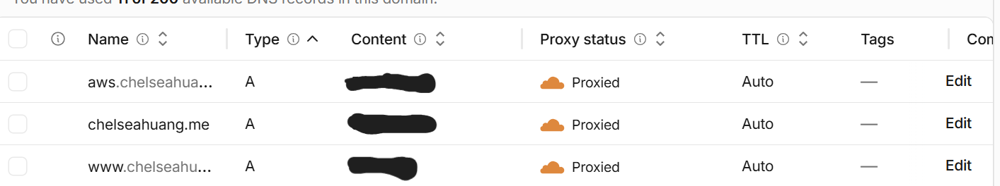
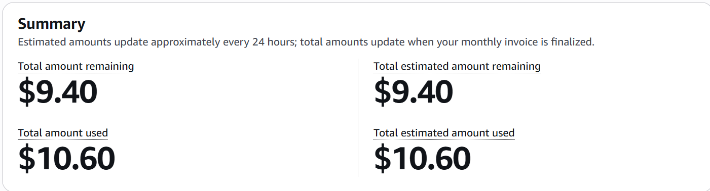

# Exercise 07: Migrate the site from Railway to AWS

Domain: `chelseahuang.me`. Test subdomain: `aws.chelseahuang.me`. Times are Pacific. Diagram: [README → AWS deployment](../../README.md#aws-deployment). Full log of every command and correction: [AWS migration plan](../superpowers/plans/2026-10-29-aws-migration.md).

## 1. Architecture decision

I chose one EC2 t3.micro server for the app with a Single-AZ RDS PostgreSQL 18 database over EC2 with PostgreSQL on the same server, because I wanted AWS to run the database's backups, patching and hardware, and I accept paying about $14 a month more for RDS and losing the database if its one availability zone goes down.

## 2. Backup record

| | |
|---|---|
| Backup | 2026-10-29 15:13, `pg_dump` 18.6 custom format of the Railway database (4.7 KB; profile 1 row, projects 4 rows). Copies outside the repo in a local folder locked to my user and in OneDrive, with SHA-256 checksums. No uploaded files: the only file the site serves (my resume PDF) is in Git. |
| Restore test | 2026-10-29: restored into a new local database in 0.49 s without touching Railway; row counts and row hashes matched Railway's at dump time; the app ran on the restored copy (`/health`, `/`, `/resume` all 200). |
| Restore on AWS | 2026-11-10: the same file (checksum matched) restored into RDS from the EC2 server in 0.12 s. Profile row hash matches the 2026-10-29 value; 4 project titles and next id 8 match. |
| Data loss I accept (RPO) | 24 hours (RDS backs up daily), and never more than the last content change for my own exports, since I only change content by hand a few times a month. |
| Recovery time I accept (RTO) | 2 hours. The restore takes under a second; the time is creating or reaching a database and pointing the app at it. |

## 3. Verification on `aws.chelseahuang.me`

| What I tested | Evidence | Result |
|---|---|---|
| DNS record for the test name | `A aws.chelseahuang.me → <the server's Elastic IP>`, **proxied**, created 2026-11-10 12:26 with the Cloudflare CLI; other records unchanged | Pass |
| App on the server, against RDS | `curl 127.0.0.1:8000/health` → `{"status":"ok"}`; home page has the 4 projects and no "temporarily unavailable"; `/resume` → `200 application/pdf` | Pass |
| App comes back after a reboot | `sudo systemctl reboot`; `/health` ok again about 10 s later with no other command | Pass |
| Database is private | RDS `PubliclyAccessible: false`; its security group allows 5432 only from the web server's group | Pass |
| Server is locked to Cloudflare | `curl -m 6 -sk https://<Elastic IP>/` from my laptop times out (exit 28): 443 is only open to Cloudflare's ranges | Pass |
| Origin certificate on nginx | Cloudflare origin certificate for `chelseahuang.me` and `*.chelseahuang.me`, valid to 2041; key and certificate public-key hashes match; `nginx -t` ok; on the server, `curl --cacert <Cloudflare origin root> --resolve aws.chelseahuang.me:443:127.0.0.1` → 200 | Pass |
| HTTPS through Cloudflare, SSL mode Full (strict) | Zone SSL mode was `full` (no certificate check); changed to `strict` 2026-11-10 12:36. From my laptop after the change: `https://aws.chelseahuang.me/health` → 200, `Server: cloudflare`, no redirect | Pass |
| Pages over HTTPS: `/`, `/health`, `/resume` | `/` → 200 `text/html`, `/health` → 200 `application/json`, `/resume` → 200 `application/pdf`, no redirect loop | Pass |
| Padlock in a browser | Not checked in a browser before the cutover (checked with curl, which fails on a bad certificate) | Not verified |
| Projects row hash | Profile hash matches the 2026-10-29 value. The projects hash I computed today (`692cf5f7…`) differs from the one in my notes (`ff17ce12…`); counts, titles and ids match, and the dump's checksum matched, so I think my query differs from Task 0's. Next step: run today's query on the local restored copy from Task 0. | Not verified |

**Deviation from the guide:** the guide uses Let's Encrypt and a grey-cloud (DNS only) record. I use a Cloudflare origin certificate with SSL mode Full (strict), so port 443 is open only to Cloudflare and port 80 isn't open at all. That means the test record has to be proxied (orange cloud) to reach the server.

## 4. Cutover status

**Cut over on 2026-11-10 at 12:37.** The apex record changed from `CNAME → pfg32veb.up.railway.app` (DNS only, my rollback value) to `A → <the server's Elastic IP>`, proxied (the IP stays out of this file so the server stays hidden behind Cloudflare). Mail and `www` records unchanged.

What went wrong: Railway's trial ended before I cut over, so `chelseahuang.me` returned Railway's 404 page from about 2026-11-07 until 12:37 today. Railway couldn't keep serving during the checks, and I couldn't take the planned final dump. The 2026-10-29 backup is the final data: I made no content edits after it. Next time I'd cut over a few days before the trial ends, not on the last day.

Checks after cutover, from my laptop: `/`, `/health`, `/resume`, `/privacy` → 200 with no redirect; `Server: cloudflare` (was `railway-hikari`); all 4 project titles shown; `/resume` SHA-256 `d52b060e…` matches the PDF in Git. `www` → 301 → `https://chelseahuang.me/` → 200 when fetched from outside my network. On the campus Wi-Fi, `www` fails (DNS gives odd answers and the TLS handshake is reset) while the apex works on the same Cloudflare IP, so I think the network filters it. I'll check it again from home.

What's left: disconnect Railway from GitHub and remove its SSH key, take an independent `pg_dump` from RDS, merge `aws-migration` into `main`, and update the deploy steps in the README. I'll finish these by 2026-11-12.

DNS record screenshot: 

## 5. Cost

Estimate (plan, section 6, AWS price list files checked 2026-11-03): **$25.86 a month**. EC2 t3.micro $7.59, its 8 GB disk $0.64, Elastic IP $3.65, RDS db.t4g.micro $11.68, RDS 20 GB storage $2.30, backups and data transfer $0.

Account owner's billing page now: 
